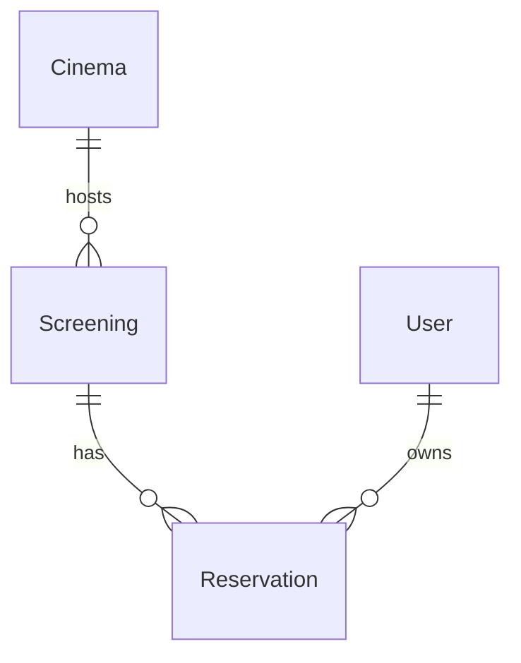

# Architecture

The React application in `src/App.jsx` holds the logged-in user, forms, screenings, and seat selection in memory. Refreshing the page loses login state. Fetch requests use `VITE_API_BASE_URL` or `/api`. Vite proxies the latter to the local API during development; a built app can be served by ASP.NET static file middleware in the same origin.

Controllers use an EF Core `AppDbContext` directly. `Program.cs` configures SQLite, applies committed migrations, optionally bootstraps an administrator, enables Swagger, and maps controllers and the SPA fallback. CORS permits `http://localhost:5173`; CORS is not authentication.

| Entity | Important fields |
| --- | --- |
| Cinema | ID, name, rows, seats per row |
| Screening | ID, film title, start time, cinema ID |
| User | ID, username, names, phone, email, plaintext password, role, row version |
| Reservation | ID, screening ID, user ID, row, seat, UTC creation time |

Reservations have foreign keys to users and screenings with cascade deletion. The compound unique index on screening/row/seat is the final booking conflict guard. Reservation cancellation compares a supplied user ID with the stored owner, so this is consistency checking rather than secure ownership enforcement.

For user edits, the browser submits its last-read Base64 version. The controller compares that version with the current record, sets EF's original concurrency value, and returns 409 for stale changes. `AppDbContext` generates random 8-byte versions on insert/update because SQLite does not supply SQL Server-style updating rowversion values. The migration snapshot already reflects this model in Task 4.

Initial migrations seed three cinemas and two fixed screenings, but the cleaned startup does not create any users unless optional bootstrap values are supplied. The database path is relative to the working directory. No database from either upload is distributed.
